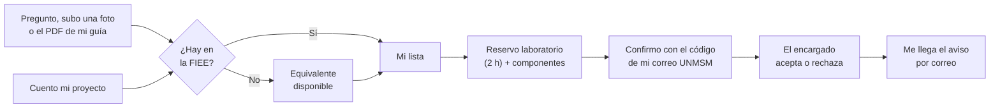
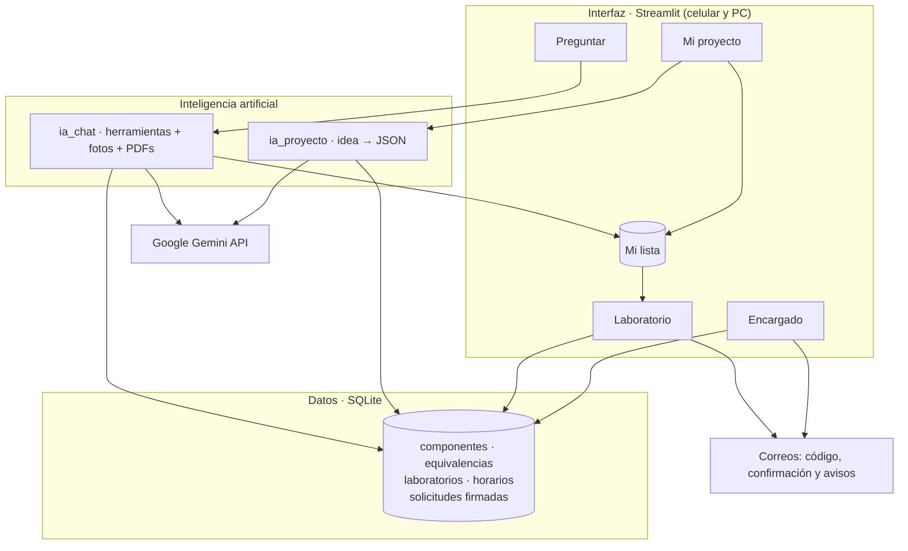

<div align="center">


### Consulta, planifica y reserva componentes y laboratorios de la FIEE-UNMSM


<br>

[](https://khipu-fiee.streamlit.app)

Funciona desde el celular o la laptop, sin instalar nada: **[khipu-fiee.streamlit.app](https://khipu-fiee.streamlit.app)**

</div>

---

## Contenido

- [Pruébalo en un minuto](#pruébalo-en-un-minuto)
- [¿Por qué "Khipu"?](#por-qué-khipu)
- [El contexto](#el-contexto)
- [El problema](#el-problema)
- [Lo que proponemos](#lo-que-proponemos)
- [Qué puedes hacer en Khipu](#qué-puedes-hacer-en-khipu)
- [Cómo usamos la IA](#cómo-usamos-la-ia)
- [Seguridad](#seguridad)
- [Cómo está construido](#cómo-está-construido)
- [Lo que viene](#lo-que-viene)
- [Correrlo en tu computadora](#correrlo-en-tu-computadora)
- [Quiénes somos](#quiénes-somos)

---

## Pruébalo en un minuto

1. Entra a **[khipu-fiee.streamlit.app](https://khipu-fiee.streamlit.app)**. Si nadie la ha usado en un rato, tarda unos segundos en despertar.
2. En **Preguntar**, escribe algo como *"¿hay 2N2222? necesito 2, agrégalo"*, o sube la foto de un componente o el PDF de tu guía.
3. En **Mi proyecto**, cuéntale tu idea (*"un robot seguidor de línea con Arduino"*) y pasa la lista a **Mi lista**.
4. En **Laboratorio**, elige día y hora, pon los datos de tu grupo y confirma la reserva con el código que te llega al correo de San Marcos.
5. Si quieres ver el otro lado, cambia a **Encargado** (arriba a la derecha). La clave te la damos nosotros.

---

## ¿Por qué "Khipu"?

Los incas llevaban el registro de sus almacenes (*qollqas*), censos e inventarios con el **khipu**: un cordón principal del que colgaban cuerdas con nudos, y cada nudo guardaba un dato.

Nos pareció la metáfora perfecta. Nuestro logo es un cordón del que cuelgan componentes electrónicos, y las pestañas de la app tienen la misma forma. Khipu es, en el fondo, el registro del almacén de nuestra facultad, hecho por estudiantes de Electrónica para estudiantes.


---

## El contexto

En la **Facultad de Ingeniería Electrónica y Eléctrica (FIEE)** de San Marcos armamos circuitos desde los primeros ciclos: fuentes, amplificadores, sistemas digitales, robots, proyectos IoT.


Para eso la facultad tiene dos recursos clave:

- **Un almacén** con circuitos integrados, transistores, conectores, resistencias, capacitores, sensores, módulos y más, que se prestan a los estudiantes.
- **Laboratorios de electrónica** que se piden formalmente y se rigen por el *Reglamento General de los Laboratorios de Electrónica* (R.D. N.° 000989-2023-D-FIEE/UNMSM).

El detalle es que los componentes solo se pueden usar dentro de un laboratorio, y hoy todo depende de ir en persona, preguntar y llenar formatos a mano.

---

## El problema

Esto lo vivimos cada ciclo:

- Vas al almacén **sin saber si hay** lo que necesitas, y muchas veces te regresas con las manos vacías.
- **No sabes qué componentes pide tu proyecto** hasta leerte toda la guía, a veces minutos antes de entrar a clase.
- Si algo falta, **nadie te dice qué lo puede reemplazar**, así que terminas comprando en Paruro algo que la facultad sí tenía.
- Hay componentes con **marcas tan pequeñas o borrosas** que cuesta saber qué son.
- Reservar un laboratorio es un **trámite manual**: formato, datos de al menos dos estudiantes, firmas y correo a la jefatura.
- Y el almacén **no sabe qué buscan los alumnos**, así que no puede anticipar qué comprar.


---

## Lo que proponemos

Una sola app web que te acompaña desde que tienes la idea del proyecto hasta que tienes el laboratorio y los componentes reservados.



Lo que el chat o tu proyecto te recomiendan se va guardando en **Mi lista**, y cuando reservas el laboratorio esos componentes ya están cargados. No tienes que volver a preguntar ni anotar nada.


---

## Qué puedes hacer en Khipu

Arriba a la derecha eliges si entras como **estudiante** o como **encargado**.

### Preguntar

Es un chat al que le hablas como a un compañero, y también le puedes mandar archivos:

| Si le mandas… | Khipu… |
|---|---|
| *"¿Hay LM358?"*, *"necesito 2 transistores 2N2222"* | Te dice cuántos hay y en qué estante. Si no hay, te propone equivalentes que sí están, con sus advertencias (*"ojo, el pinout es distinto"*). |
| La **foto** de un componente | Lo reconoce por el encapsulado y las marcas, te dice qué tan seguro está y si hay en el almacén. |
| El **PDF** de tu guía o informe | Te resume la experiencia, te dice qué componentes necesitas, revisa si están en la facultad y te da un par de consejos. |
| *"¿Hay laboratorio libre el lunes de 2 a 4?"* | Revisa los horarios y te dice qué laboratorios están libres y por qué los demás no. |

Si le dices *"agrégalo"*, lo pone en tu lista. Y algo importante: **Khipu no inventa stock**. Si algo no está en el inventario, te lo dice.

### Mi proyecto

Le cuentas qué quieres armar y te devuelve la lista de componentes, para qué sirve cada uno, si hay, si falta o si no existe en el almacén, qué equivalentes puedes usar y algunos consejos. Con un clic pasa todo a tu lista. La tomamos como un punto de partida: siempre conviene revisar el datasheet.

### Laboratorio

1. Eliges el día y una franja de 2 horas. Los laboratorios ocupados por clases u otras reservas aparecen ~~tachados~~.
2. Pones el motivo y los datos del grupo (mínimo dos personas). El de la primera fila es el **líder** y pone su correo `@unmsm.edu.pe`.
3. Los componentes de tu lista ya aparecen, con lo que realmente hay disponible en esa franja.
4. Te llega un **código de 6 dígitos** al correo del líder; lo escribes y recién ahí se guarda la reserva.
5. Recibes tu código `LAB-XXXX`, un comprobante para descargar y un correo con todo el detalle.

¿Cerraste la página? En *Consultar mi solicitud* pones tu **código de alumno** y ves todas tus reservas y en qué estado están. Cuando el encargado responde, también te llega un correo.

### Encargado

Con su clave, el encargado ve cuántas solicitudes tiene pendientes (se actualiza sola cada pocos segundos y avisa cuando llega una nueva). Desde ahí puede:

- revisar cada solicitud y aceptarla o rechazarla con una nota;
- actualizar el inventario y el stock;
- editar los laboratorios y el horario de clases;
- ver qué es lo más pedido y qué está agotado, para planificar compras.

---

## Cómo usamos la IA

No entrenamos un modelo propio. Lo que hicimos fue conectar modelos que ya existen a datos reales de la facultad, de forma que la IA nunca tenga que adivinar.

- **El chat es un agente con herramientas.** El modelo no tiene el inventario en la memoria: para responder tiene que consultar nuestra base de datos con cuatro funciones (`buscar_en_almacen`, `ver_equivalentes`, `ver_laboratorios_libres` y `agregar_a_mi_lista`).
- **Fotos y PDFs en la misma conversación.** Usamos un modelo multimodal que lee imágenes y documentos, y después verifica todo contra el inventario.
- **Mi proyecto** pide al modelo una respuesta en formato JSON, y el cruce con el stock y los equivalentes lo hace Python, sin IA, para que sea exacto.
- **Si un modelo se satura**, Khipu pasa automáticamente al siguiente sin perder la conversación.


Lo que más nos enorgullece: las equivalencias entre componentes no las inventa la IA. Las armamos y revisamos nosotros con los datasheets, porque eso es justamente lo que aprendemos en la carrera.

---

## Seguridad

Un mentor nos hizo una pregunta clave: *¿qué impide que alguien reserve a nombre de otro?* Esto fue lo que hicimos:

- **Confirmación con el correo institucional.** Antes de guardar la reserva, Khipu manda un código de 6 dígitos al correo `@unmsm.edu.pe` del líder. Solo quien tiene acceso a ese correo puede confirmar. El código vence en 10 minutos y hay un máximo de intentos.
- **Sello digital.** Cada reserva se guarda con una huella SHA-256 de sus datos. Si alguien la modifica después, el encargado lo ve de inmediato.
- **Validaciones sin IA.** Que el laboratorio esté libre, que alcance el stock en esa franja y que haya al menos dos estudiantes lo revisa Python, no el modelo.
- **El panel del encargado** pide una clave que vive en el servidor, no en el código.

Más adelante, la idea es pasar a un inicio de sesión con la cuenta de San Marcos y a firma digital con DNIe.

---

## Cómo está construido



- **Python y Streamlit** para la app web.
- **Streamlit Community Cloud** para publicarla: todos usan el mismo servidor, así que lo que reserva un alumno el encargado lo ve al instante.
- **SQLite** para el inventario, los laboratorios y las reservas.
- **Google Gemini** para el chat, las fotos, los PDFs y las listas de proyectos.
- **Gmail (SMTP) y SHA-256** para los correos y el sello de cada reserva.

Por ahora trabajamos con un inventario de ejemplo de 91 componentes e instrumentos que usamos en los cursos, y con laboratorios y horarios también de ejemplo. Cargar los datos reales es cuestión de reemplazar los archivos de `data/` o editarlos desde el panel del encargado.

---

## Lo que viene

Lo que ya funciona:

- [x] Chat con inventario real, equivalentes, fotos, PDFs y laboratorios libres
- [x] Lista de componentes a partir de la idea del proyecto
- [x] Mi lista compartida entre pestañas
- [x] Reserva de laboratorio con componentes y stock por franja
- [x] Confirmación con código al correo institucional y sello digital
- [x] Comprobante, correo de confirmación y aviso cuando el encargado responde
- [x] Panel del encargado en tiempo real
- [x] Publicada en [khipu-fiee.streamlit.app](https://khipu-fiee.streamlit.app)

Lo que nos gustaría hacer después:

- [ ] Iniciar sesión con la cuenta `@unmsm.edu.pe`
- [ ] Firma digital con DNIe (RENIEC)
- [ ] Una base de datos en la nube, para que nada se pierda si el servidor se reinicia
- [ ] Un foro para compartir proyectos y dudas
- [ ] Trabajar con el inventario real del almacén y llevarlo a otros laboratorios y facultades

---

## Correrlo en tu computadora

Para usarlo no necesitas nada de esto: basta con abrir **[khipu-fiee.streamlit.app](https://khipu-fiee.streamlit.app)**. Esto es para quien quiera revisar o mejorar el código.

```bash
git clone https://github.com/AldoRuiz07/KHIPU-.git
cd KHIPU-
python -m venv .venv
.venv\Scripts\activate            # en Mac o Linux: source .venv/bin/activate
pip install -r requirements.txt
copy .env.ejemplo .env            # en Mac o Linux: cp .env.ejemplo .env
streamlit run app.py
```

En el archivo `.env` (o en los *Secrets* de Streamlit Cloud) van estas variables:

| Variable | Para qué sirve |
|---|---|
| `GEMINI_API_KEY` | Tu clave de [Google AI Studio](https://aistudio.google.com) (es gratuita) |
| `MODELOS` | Los modelos a usar, en orden y separados por comas |
| `CLAVE_ENCARGADO` | La clave del panel del encargado |
| `CORREO_REMITENTE` y `CORREO_CLAVE` | La cuenta de Gmail que envía los correos y su contraseña de aplicación |

---

## Quiénes somos

Somos tres estudiantes de **Ingeniería Electrónica de San Marcos**. Más de una vez fuimos al almacén sin saber si había lo que buscábamos, compramos algo que la facultad ya tenía o llenamos solicitudes a mano. Khipu nació de eso.

<table align="center">
  <tr>
    <td align="center" width="240">
      <br>
      <b>Karla Montes</b><br>
      <sub>Base de datos y reservas de laboratorio</sub><br>
      <a href="https://www.linkedin.com/in/karlamontesm">LinkedIn</a>
    </td>
    <td align="center" width="240">
      <br>
      <b>Aldo Ruiz</b><br>
      <sub>Chat con IA, fotos y PDFs</sub><br>
      <a href="https://www.linkedin.com/in/aldoruiz07/">LinkedIn</a>
    </td>
    <td align="center" width="240">
      <br>
      <b>Erik Espinel</b><br>
      <sub>Interfaz, Mi proyecto y panel del encargado</sub><br>
      <a href="https://www.linkedin.com/in/erik-espinel-bernilla">LinkedIn</a>
    </td>
  </tr>
</table>

<div align="center">

<br>

**Hecho pensando en la FIEE · Universidad Nacional Mayor de San Marcos**

</div>
