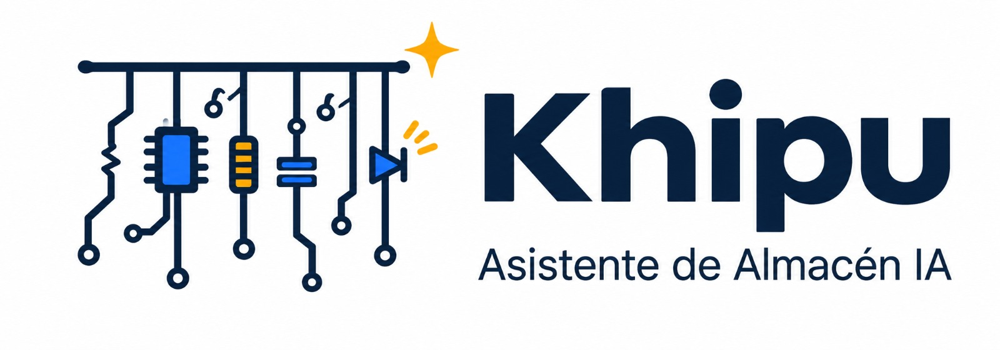
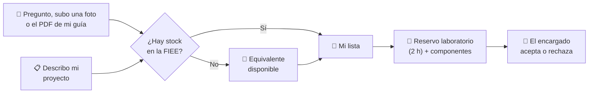
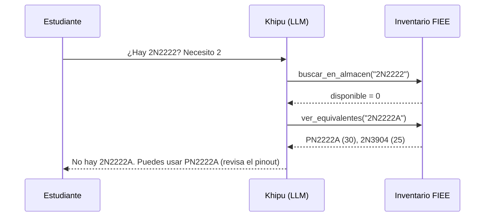
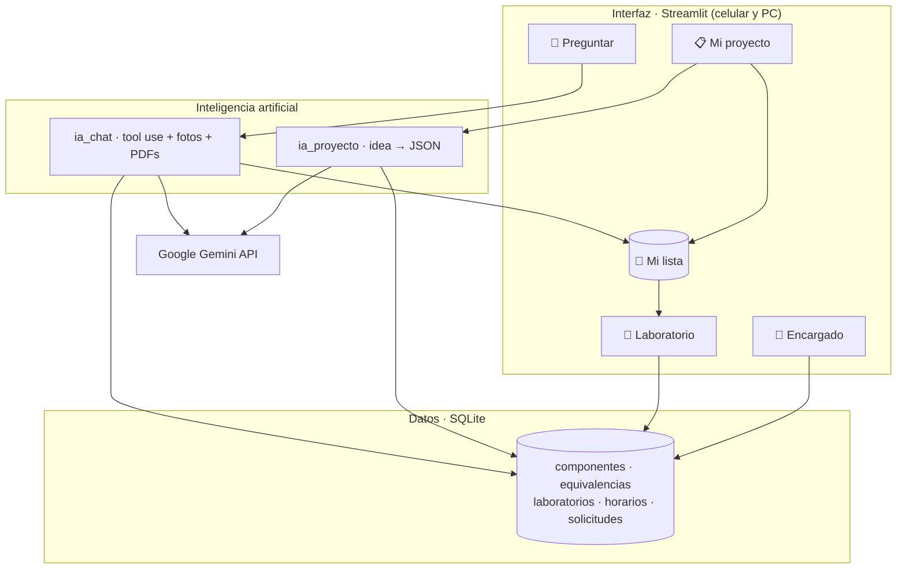

<div align="center">



### Consulta, planifica y reserva: componentes y laboratorios de la FIEE-UNMSM, con inteligencia artificial


</div>

---

## 📑 Contenido

- [¿Por qué "Khipu"?](#-por-qué-khipu)
- [Contexto: la FIEE y su almacén](#-contexto-la-fiee-y-su-almacén)
- [La problemática](#-la-problemática)
- [Nuestra propuesta](#-nuestra-propuesta)
- [Qué hace el aplicativo](#-qué-hace-el-aplicativo)
- [Cómo usamos la IA](#-cómo-usamos-la-ia)
- [Arquitectura](#-arquitectura)
- [Hoja de ruta](#-hoja-de-ruta)
- [Cómo ejecutarlo](#-cómo-ejecutarlo)
- [Quiénes somos](#-quiénes-somos)

---

## 🧶 ¿Por qué "Khipu"?

El **khipu** fue el sistema de cuerdas y nudos con el que los incas registraban inventarios, censos y almacenes (*qollqas*). Un cordón principal, cuerdas colgantes y nudos que guardaban información precisa.

Nuestro logo retoma esa idea: un cordón del que cuelgan componentes electrónicos. **Khipu es el registro inteligente del almacén de nuestra facultad**, hecho por estudiantes de Ingeniería Electrónica para estudiantes.


---

## 🏛️ Contexto: la FIEE y su almacén

La **Facultad de Ingeniería Electrónica y Eléctrica (FIEE)** de la Universidad Nacional Mayor de San Marcos forma a cientos de estudiantes que, desde los primeros ciclos, desarrollan proyectos prácticos: fuentes reguladas, amplificadores, sistemas digitales, robots, IoT.


Para eso la facultad cuenta con:

- 📦 **Un almacén de componentes**: circuitos integrados, transistores, conectores, resistencias, capacitores, sensores, módulos y más componentes que se prestan a los estudiantes.
- 🔬 **Laboratorios de electrónica**: aulas equipadas que se solicitan formalmente y se rigen por el *Reglamento General de los Laboratorios de Electrónica* (R.D. N.° 000989-2023-D-FIEE/UNMSM).

Hoy, consultar qué hay en el almacén o pedir un laboratorio depende de **ir presencialmente, preguntar y llenar formatos a mano**.

---

## ❗ La problemática

| # | Problema | Consecuencia |
|:-:|---|---|
| 1 | El estudiante **no sabe si hay** el componente antes de ir al almacén. | Viajes en vano y tiempo perdido entre clases. |
| 2 | No sabe **qué componentes necesita** su proyecto hasta leer toda la guía o el informe. | Llega a clase sin preparar o pide lo que no corresponde. |
| 3 | Si algo falta, **no conoce equivalentes** que sí estén disponibles. | Compras innecesarias fuera de la universidad (por ejemplo, en Paruro). |
| 4 | Muchos componentes tienen **marcas pequeñas o borrosas**. | Es difícil identificarlos y saber si hay más. |
| 5 | Reservar un laboratorio exige un **trámite manual**: formato, datos de al menos 2 estudiantes, firmas y correo a la jefatura. | Errores, demoras y solicitudes incompletas. |
| 6 | El almacén **no tiene datos** de qué buscan los estudiantes. | No puede anticipar compras para el siguiente ciclo. |

---


## 💡 Nuestra propuesta

> **Un solo aplicativo web, accesible desde el celular, que acompaña al estudiante desde la idea de su proyecto hasta tener el laboratorio y los componentes reservados.**



En la FIEE los componentes **solo se usan dentro de un laboratorio**. Por eso Khipu une ambas cosas: lo que el chat o tu proyecto te recomiendan se guarda en **Mi lista**, y al reservar el laboratorio esos componentes ya están cargados. **No tienes que volver a preguntar ni anotar nada.**


---

## 📱 Qué hace el aplicativo

El aplicativo tiene **4 pestañas** y una barra lateral con **🛒 Mi lista**.

### 1. 💬 Preguntar: chat con texto, fotos y PDFs
Un chat al que le escribes como a un compañero, y al que también le puedes **adjuntar archivos**:

| Le envías… | Khipu… |
|---|---|
| ✍️ *"¿Hay LM358?"* · *"Necesito 2 transistores 2N2222"* | Responde con **stock real y ubicación**. Si no hay, propone **equivalentes verificados** con sus advertencias (*"pinout distinto"*). |
| 📷 Una **foto** del componente (desde la cámara del celular) | Lo **identifica** por su encapsulado y marcas, indica su **nivel de confianza** y te dice si hay en el almacén. |
| 📄 El **PDF** de tu guía o informe | Resume qué se hace, lista **qué componentes necesitas**, revisa si están en la facultad y te da **tips clave**, sin que tengas que leer todo antes de clase. |

Si le dices *"agrégalo"*, lo guarda en **Mi lista**. Khipu **nunca inventa stock**: si algo no está en el inventario, lo dice. El historial del chat se mantiene mientras usas la app.

### 2. 📋 Mi proyecto: de la idea a la lista de componentes
Describe el proyecto que tienes en mente (*"robot seguidor de línea con Arduino"*). Khipu:
- propone los componentes y su función en el circuito,
- los cruza con el inventario: ✅ disponible · ⚠️ insuficiente · ❌ no existe,
- sugiere **equivalentes con stock** para lo que falta,
- te da **tips** para armarlo,
- y con un clic pasa todo a **Mi lista**. Así no gastas en comprar lo que la facultad ya tiene.

> La lista se presenta como **punto de partida a verificar** con el datasheet.

### 3. 🔬 Laboratorio: reserva la sala y tus componentes
1. Eliges la **fecha** y la **franja de 2 horas** (por ejemplo, *2:00–4:00 p. m.*).
2. Ves los laboratorios: los ocupados por clases u otras reservas aparecen ~~tachados~~.
3. Escribes el motivo y los datos de los estudiantes (**mínimo 2**, con código y correo `@unmsm.edu.pe`).
4. Los componentes de **Mi lista** ya aparecen cargados, con lo **disponible en esa franja**.
5. Envías y recibes un código `LAB-XXXX` para consultar el estado: ⏳ pendiente · ✅ aceptada · ❌ rechazada.

Sin formatos a mano ni correos: la solicitud llega directo al encargado.

### 4. 🔐 Encargado: panel con clave
Solo accede el personal con la clave:

| Sección | Qué puede hacer |
|---|---|
| **Solicitudes** | Ver cada solicitud (laboratorio, horario, motivo, estudiantes y componentes), **aceptarla o rechazarla** con una nota, y marcarla como finalizada. |
| **Componentes** | **Actualizar el inventario**: agregar, editar o quitar componentes y su stock. |
| **Laboratorios** | Editar los laboratorios y el **horario de clases**, que bloquea esas franjas cada semana. |
| **Demanda** | Ver lo más pedido y lo agotado, para **planificar compras** del siguiente ciclo. |

---

## 🤖 Cómo usamos la IA

No entrenamos modelos propios: **aplicamos modelos existentes a un problema real, con datos controlados**.

| Función | Técnica | Por qué es confiable |
|---|---|---|
| Chat de disponibilidad | **LLM con *tool use*** (function calling) | El modelo no conoce el stock: debe consultarlo llamando a funciones de nuestra base de datos. También usa una herramienta para agregar a Mi lista. |
| Proyecto → lista | **LLM con salida estructurada (JSON)** | El cruce con el stock y los equivalentes lo hace Python de forma determinista y auditable. |
| Fotos y PDFs en el chat | **Modelo multimodal**: lee imágenes y documentos dentro de la misma conversación | Identifica con nivel de confianza y siempre verifica en el inventario. |
| Robustez | **Cambio automático de modelo** | Si un modelo está saturado o sin cuota, pasa al siguiente sin perder la conversación. |



**Nuestro diferencial:** las equivalencias entre componentes son **curadas y verificadas con datasheet por estudiantes de Ingeniería Electrónica**, no generadas por la IA.

---

## 🏗️ Arquitectura



| Tecnología | Uso |
|---|---|
| **Python + Streamlit** | Aplicativo web responsivo, sin instalación para el usuario |
| **SQLite** | Inventario, equivalencias, reservas, consultas |
| **Google Gemini API** | Chat con herramientas, salida estructurada, visión |
| **pandas** | Tablas y reportes |

---

## 🗺️ Hoja de ruta

| Estado | Funcionalidad |
|:-:|---|
| ✅ MVP | Chat de disponibilidad conectado al inventario, con equivalentes |
| ✅ MVP | Mi proyecto: idea → lista de componentes con equivalentes y tips |
| ✅ MVP | Reserva de laboratorio por franja de 2 h con componentes |
| 🚧 En desarrollo | Fotos y PDFs en el chat · Mi lista compartida entre pestañas |
| 🚧 En desarrollo | Panel del encargado: aceptar/rechazar y actualizar inventario y laboratorios |
| 🔭 Visión | Inicio de sesión con correo institucional `@unmsm.edu.pe` |
| 🔭 Visión | Notificaciones por correo cuando la solicitud se acepta o se rechaza |
| 🔭 Visión | Foro de proyectos y dudas entre estudiantes |
| 🔭 Visión | Inventario real del almacén y escalamiento a otros laboratorios y facultades |

> Durante la hackathon se usa un **inventario de ejemplo** con 62 componentes típicos de los cursos de la FIEE. Para usar el inventario real basta con reemplazar un archivo CSV.

---

## ▶️ Cómo ejecutarlo

```bash
git clone https://github.com/<usuario>/khipu.git
cd khipu
python -m venv .venv
.venv\Scripts\activate            # Windows  ·  Mac/Linux: source .venv/bin/activate
pip install -r requirements.txt
copy .env.ejemplo .env            # pega tu clave de Gemini en .env
streamlit run app.py
```

Obtén una clave gratuita en [Google AI Studio](https://aistudio.google.com). En `.env`, `MODELOS` es la lista de modelos en orden de preferencia, separados por comas.

---

## 👥 Quiénes somos

Somos estudiantes de **Ingeniería Electrónica de la UNMSM**. Vivimos el problema cada ciclo: ir al almacén sin saber qué hay, comprar lo que la facultad ya tenía y llenar solicitudes a mano. Por eso decidimos resolverlo.

| | Integrante | Rol |
|:-:|---|---|
| 🔧 | **KARLA MONTES** | Base de datos y pestaña Laboratorio: franjas, ocupación, solicitudes |
| 🤖 | **ALDO RUIZ** | Pestaña Preguntar: chat con *tool use*, fotos y PDFs, cambio automático de modelo, equivalencias |
| 🎨 | **ERIK ESPINEL** | Interfaz y Mi lista, pestaña Mi proyecto, panel del Encargado, publicación |

<div align="center">

**Hecho pensando en la FIEE · Universidad Nacional Mayor de San Marcos**

</div>
