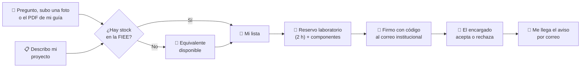
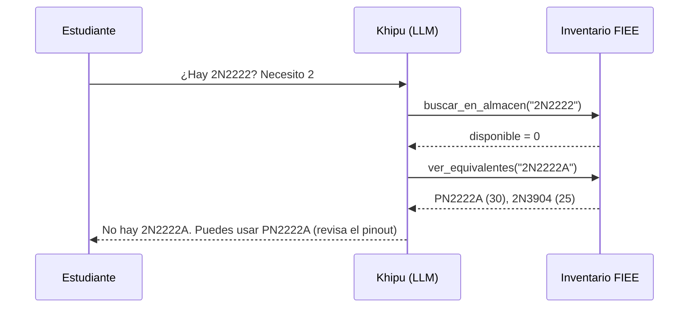
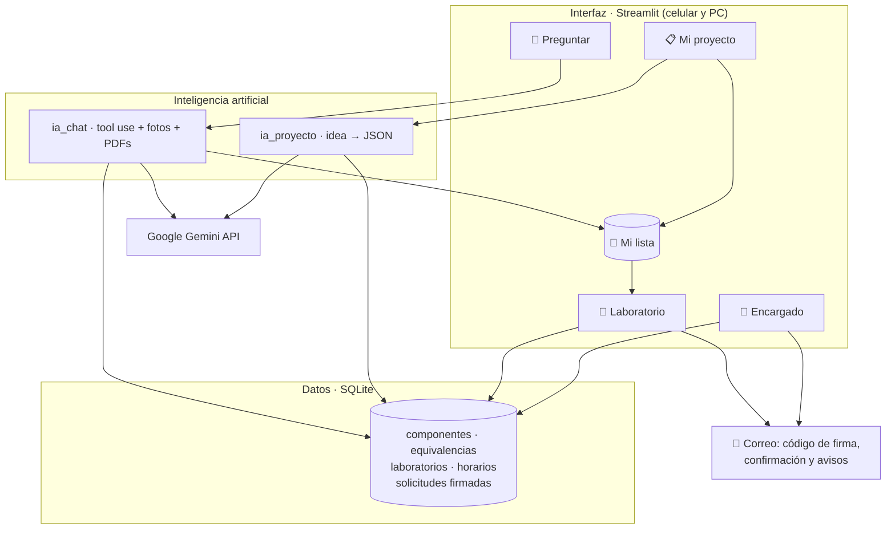

<div align="center">


### Consulta, planifica y reserva: componentes y laboratorios de la FIEE-UNMSM, con inteligencia artificial


<br>

[](https://khipu-fiee.streamlit.app)

**Pruébalo ahora, sin instalar nada (celular o PC): [khipu-fiee.streamlit.app](https://khipu-fiee.streamlit.app)**

</div>

---

## 📑 Contenido

- [Pruébalo en 1 minuto](#-pruébalo-en-1-minuto)
- [¿Por qué "Khipu"?](#-por-qué-khipu)
- [Contexto: la FIEE y su almacén](#-contexto-la-fiee-y-su-almacén)
- [La problemática](#-la-problemática)
- [Nuestra propuesta](#-nuestra-propuesta)
- [Qué hace el aplicativo](#-qué-hace-el-aplicativo)
- [Cómo usamos la IA](#-cómo-usamos-la-ia)
- [Seguridad y confianza](#-seguridad-y-confianza)
- [Arquitectura](#-arquitectura)
- [Hoja de ruta](#-hoja-de-ruta)
- [Cómo ejecutarlo](#-cómo-ejecutarlo)
- [Quiénes somos](#-quiénes-somos)

---

## 🚀 Pruébalo en 1 minuto

1. Entra a **[khipu-fiee.streamlit.app](https://khipu-fiee.streamlit.app)** desde tu celular o tu PC.
   *Si la app estuvo un rato sin uso, Streamlit la "despierta" en unos segundos.*
2. En **💬 Preguntar** escribe *"¿Hay 2N2222? necesito 2, agrégalo"* o sube la **foto** de un componente o el **PDF** de tu guía.
3. En **📋 Mi proyecto** escribe *"robot seguidor de línea con Arduino"* → **Agregar a Mi lista**.
4. En **🔬 Laboratorio** elige fecha y horario, pon los datos del grupo (el líder con su correo `@unmsm.edu.pe`), **firma con el código** que te llega al correo y listo.
5. Arriba a la derecha cambia a **🔐 Encargado** para ver cómo llega la solicitud y aceptarla *(la clave la proporciona el equipo)*.

---

## 🧶 ¿Por qué "Khipu"?

El **khipu** fue el sistema de cuerdas y nudos con el que los incas registraban inventarios, censos y almacenes (*qollqas*). Un cordón principal, cuerdas colgantes y nudos que guardaban información precisa.

Nuestro logo retoma esa idea: un cordón del que cuelgan componentes electrónicos. **Khipu es el registro inteligente del almacén de nuestra facultad**, hecho por estudiantes de Ingeniería Electrónica para estudiantes.


---

## 🏛️ Contexto: la FIEE y su almacén

La **Facultad de Ingeniería Electrónica y Eléctrica (FIEE)** de la Universidad Nacional Mayor de San Marcos forma a cientos de estudiantes que, desde los primeros ciclos, desarrollan proyectos prácticos: fuentes reguladas, amplificadores, sistemas digitales, robots, IoT.


Para eso la facultad cuenta con:

- 📦 **Un almacén de componentes**: circuitos integrados, transistores, conectores, resistencias, capacitores, sensores, módulos y más componentes que se prestan a los estudiantes.
- 🔬 **Laboratorios de electrónica**: aulas equipadas que se solicitan formalmente y se rigen por el *Reglamento General de los Laboratorios de Electrónica* (R.D. N.° 000989-2023-D-FIEE/UNMSM).

Hoy, consultar qué hay en el almacén o pedir un laboratorio depende de **ir presencialmente, preguntar y llenar formatos a mano**.

---

## ❗ La problemática

| # | Problema | Consecuencia |
|:-:|---|---|
| 1 | El estudiante **no sabe si hay** el componente antes de ir al almacén. | Viajes en vano y tiempo perdido entre clases. |
| 2 | No sabe **qué componentes necesita** su proyecto hasta leer toda la guía o el informe. | Llega a clase sin preparar o pide lo que no corresponde. |
| 3 | Si algo falta, **no conoce equivalentes** que sí estén disponibles. | Compras innecesarias fuera de la universidad (por ejemplo, en Paruro). |
| 4 | Muchos componentes tienen **marcas pequeñas o borrosas**. | Es difícil identificarlos y saber si hay más. |
| 5 | Reservar un laboratorio exige un **trámite manual**: formato, datos de al menos 2 estudiantes, firmas y correo a la jefatura. | Errores, demoras y solicitudes incompletas. |
| 6 | El almacén **no tiene datos** de qué buscan los estudiantes. | No puede anticipar compras para el siguiente ciclo. |

---


## 💡 Nuestra propuesta

> **Un solo aplicativo web, accesible desde el celular, que acompaña al estudiante desde la idea de su proyecto hasta tener el laboratorio y los componentes reservados.**



En la FIEE los componentes **solo se usan dentro de un laboratorio**. Por eso Khipu une ambas cosas: lo que el chat o tu proyecto te recomiendan se guarda en **Mi lista**, y al reservar el laboratorio esos componentes ya están cargados. **No tienes que volver a preguntar ni anotar nada.**


---

## 📱 Qué hace el aplicativo

Arriba a la derecha se elige el modo: **🎓 Estudiante** (3 pestañas y la barra lateral **🛒 Mi lista**) o **🔐 Encargado** (panel con clave). Las pestañas tienen forma de *khipu*: un cordón con un nudo por pestaña.

### 1. 💬 Preguntar: chat con texto, fotos y PDFs
Un chat al que le escribes como a un compañero, y al que también le puedes **adjuntar archivos**:

| Le envías… | Khipu… |
|---|---|
| ✍️ *"¿Hay LM358?"* · *"Necesito 2 transistores 2N2222"* | Responde con **stock real y ubicación**. Si no hay, propone **equivalentes verificados** con sus advertencias (*"pinout distinto"*). |
| 📷 Una **foto** del componente (desde la cámara del celular) | Lo **identifica** por su encapsulado y marcas, indica su **nivel de confianza** y te dice si hay en el almacén. |
| 📄 El **PDF** de tu guía o informe | Resume qué se hace, lista **qué componentes necesitas**, revisa si están en la facultad y te da **tips clave**, sin que tengas que leer todo antes de clase. |
| 🔬 *"¿Hay laboratorio libre el lunes de 2 a 4?"* | Consulta los **horarios reales** y responde qué laboratorios están libres y por qué los otros están ocupados (clase o reserva). |

Si le dices *"agrégalo"*, lo guarda en **Mi lista**. Khipu **nunca inventa stock**: si algo no está en el inventario, lo dice. El historial del chat se mantiene mientras usas la app.

### 2. 📋 Mi proyecto: de la idea a la lista de componentes
Describe el proyecto que tienes en mente (*"robot seguidor de línea con Arduino"*). Khipu:
- propone los componentes y su función en el circuito,
- los cruza con el inventario: ✅ disponible · ⚠️ insuficiente · ❌ no existe,
- sugiere **equivalentes con stock** para lo que falta,
- te da **tips** para armarlo,
- y con un clic pasa todo a **Mi lista**. Así no gastas en comprar lo que la facultad ya tiene.

> La lista se presenta como **punto de partida a verificar** con el datasheet.

### 3. 🔬 Laboratorio: reserva la sala y tus componentes
1. Eliges la **fecha** y la **franja de 2 horas** (por ejemplo, *2:00–4:00 p. m.*).
2. Ves los laboratorios: los ocupados por clases u otras reservas aparecen ~~tachados~~.
3. Escribes el motivo y los datos del grupo (**mínimo 2 estudiantes**). El de la **fila 1 es el líder** y pone su correo `@unmsm.edu.pe`.
4. Los componentes de **Mi lista** ya aparecen cargados, con lo **disponible en esa franja**.
5. **Firmas la solicitud:** te llega un **código de 6 dígitos** al correo institucional del líder; lo escribes y recién ahí se guarda (ver [Seguridad](#-seguridad-y-confianza)).
6. Recibes el código `LAB-XXXX`, un **comprobante descargable** y un **correo de confirmación** con laboratorio, fecha, hora, componentes y sello digital.

**¿Cerraste la página?** En *Consultar mi solicitud* escribe tu **código de alumno** y verás **todas tus reservas** con su estado: ⏳ pendiente · ✅ aceptada · ❌ rechazada · 🏁 finalizada. Cuando el encargado decide, **te llega un correo**.

Sin formatos a mano ni idas a la jefatura: la solicitud firmada llega directo al encargado.

### 4. 🔐 Encargado: panel con clave
Se entra desde el selector **🔐 Encargado** (arriba a la derecha). Arriba ve contadores **⏳ Pendientes · ✅ Aceptadas · 🔴 Agotados** que **se actualizan solos cada 5 segundos**; si llega una solicitud nueva, aparece un aviso 🔔.

| Sección | Qué puede hacer |
|---|---|
| **Solicitudes** | Ver cada solicitud (laboratorio, horario, motivo, estudiantes, componentes) con su **🔏 firma verificada**, **aceptarla o rechazarla** con una nota (el líder recibe un correo) y marcarla como finalizada. |
| **Componentes** | **Actualizar el inventario**: agregar, editar o quitar componentes y su stock. |
| **Laboratorios** | Editar los laboratorios y el **horario de clases**, que bloquea esas franjas cada semana. |
| **Demanda** | Ver lo más pedido y lo agotado, para **planificar compras** del siguiente ciclo. |

---

## 🤖 Cómo usamos la IA

No entrenamos modelos propios: **aplicamos modelos existentes a un problema real, con datos controlados**.

| Función | Técnica | Por qué es confiable |
|---|---|---|
| Chat de disponibilidad | **Agente LLM con *tool use*** (function calling) | El modelo no conoce el stock ni los horarios: los consulta con 4 herramientas (`buscar_en_almacen`, `ver_equivalentes`, `ver_laboratorios_libres`, `agregar_a_mi_lista`) que leen nuestra base de datos. |
| Proyecto → lista | **LLM con salida estructurada (JSON)** | El cruce con el stock y los equivalentes lo hace Python de forma determinista y auditable. |
| Fotos y PDFs en el chat | **Modelo multimodal**: lee imágenes y documentos dentro de la misma conversación | Identifica con nivel de confianza y siempre verifica en el inventario. |
| Robustez | **Cambio automático de modelo** | Si un modelo está saturado o sin cuota, pasa al siguiente sin perder la conversación. |



**Nuestro diferencial:** las equivalencias entre componentes son **curadas y verificadas con datasheet por estudiantes de Ingeniería Electrónica**, no generadas por la IA.

---

## 🔐 Seguridad y confianza

| Riesgo | Cómo lo resuelve Khipu |
|---|---|
| **Suplantación:** alguien reserva con el nombre y código de otro alumno | **Firma electrónica simple:** antes de guardar, se envía un **código de 6 dígitos al correo `@unmsm.edu.pe` del líder** (vence en 10 min, máximo 5 intentos). Solo quien controla ese correo institucional puede reservar a su nombre. |
| **Alteración de datos** | Cada solicitud se **sella con una huella SHA-256** de sus datos y de la verificación. El encargado ve **🔏 Firma válida**; si algo se modifica, aparece **⚠️ el sello no coincide**. |
| **La IA inventa stock** | La IA no tiene el inventario en la memoria: solo puede leerlo con funciones. Las validaciones (franjas, stock por franja, mínimo 2 estudiantes) son **deterministas**, en Python. |
| **Acceso al panel** | El modo Encargado pide una clave guardada como *secret* del servidor, no en el código. |
| **Pérdida del código de reserva** | Comprobante descargable, correo de confirmación y búsqueda por código de alumno. |

> En producción, la firma evoluciona a **inicio de sesión institucional** y **firma digital con DNIe (RENIEC)**.

---

## 🏗️ Arquitectura



| Tecnología | Uso |
|---|---|
| **Python + Streamlit** | Aplicativo web responsivo, sin instalación para el usuario |
| **Streamlit Community Cloud** | Publicación en internet: todos usan el mismo servidor y ven los cambios en tiempo real |
| **SQLite** | Inventario, equivalencias, reservas, consultas |
| **Google Gemini API** | Chat con herramientas, salida estructurada, visión |
| **pandas** | Tablas y reportes |
| **SMTP (Gmail) + SHA-256** | Código de firma, correos de confirmación y sello digital |

---

## 🗺️ Hoja de ruta

| Estado | Funcionalidad |
|:-:|---|
| ✅ Listo | Chat conectado al inventario, con equivalentes, fotos, PDFs y consulta de laboratorios libres |
| ✅ Listo | Mi proyecto: idea → lista de componentes con equivalentes y tips |
| ✅ Listo | Mi lista compartida entre pestañas |
| ✅ Listo | Reserva de laboratorio por franja de 2 h con componentes y stock por franja |
| ✅ Listo | Firma electrónica simple (código al correo institucional) y sello SHA-256 |
| ✅ Listo | Comprobante descargable, correo de confirmación y avisos de aceptación o rechazo |
| ✅ Listo | Panel del encargado en tiempo real: solicitudes, inventario, laboratorios y demanda |
| ✅ Listo | Publicado en internet: [khipu-fiee.streamlit.app](https://khipu-fiee.streamlit.app) |
| 🔭 Visión | Inicio de sesión con la cuenta institucional `@unmsm.edu.pe` |
| 🔭 Visión | Firma digital con DNIe (RENIEC) |
| 🔭 Visión | Base de datos en la nube (PostgreSQL) para que los datos persistan entre reinicios |
| 🔭 Visión | Foro de proyectos y dudas entre estudiantes |
| 🔭 Visión | Inventario real del almacén y escalamiento a otros laboratorios y facultades |

> Durante la hackathon se usa un **inventario de ejemplo** con **91 componentes e instrumentos** típicos de los cursos de la FIEE, y **laboratorios y horarios de ejemplo**. Para usar los datos reales basta con reemplazar los CSV de `data/` o editarlos desde el panel del encargado.

---

## ▶️ Cómo ejecutarlo

**Para usarlo:** no hace falta instalar nada → **[khipu-fiee.streamlit.app](https://khipu-fiee.streamlit.app)**

**Para desarrollarlo en tu computadora:**

```bash
git clone https://github.com/AldoRuiz07/KHIPU-.git
cd KHIPU-
python -m venv .venv
.venv\Scripts\activate            # Windows  ·  Mac/Linux: source .venv/bin/activate
pip install -r requirements.txt
copy .env.ejemplo .env            # Mac/Linux: cp .env.ejemplo .env
streamlit run app.py
```

Configura tu `.env` (en Streamlit Cloud, lo mismo va en **Secrets**):

| Variable | Para qué |
|---|---|
| `GEMINI_API_KEY` | Clave gratuita de [Google AI Studio](https://aistudio.google.com) |
| `MODELOS` | Modelos en orden de preferencia, separados por comas; si uno se satura, pasa al siguiente |
| `CLAVE_ENCARGADO` | Clave del panel del encargado |
| `CORREO_REMITENTE` · `CORREO_CLAVE` | Cuenta Gmail y su *contraseña de aplicación* para enviar los correos |

---

## 👥 Quiénes somos

Somos estudiantes de **Ingeniería Electrónica de la UNMSM**. Vivimos el problema cada ciclo: ir al almacén sin saber qué hay, comprar lo que la facultad ya tenía y llenar solicitudes a mano. Por eso decidimos resolverlo.

| | Integrante | Rol |
|:-:|---|---|
| 🔧 | **KARLA MONTES** | Base de datos, pestaña Laboratorio: franjas, ocupación, solicitudes, firma y comprobantes |
| 🤖 | **ALDO RUIZ** | Pestaña Preguntar: agente con *tool use*, fotos, PDFs y laboratorios libres; cambio automático de modelo; equivalencias; documentación |
| 🎨 | **ERIK ESPINEL** | Interfaz y diseño khipu, Mi lista, pestaña Mi proyecto, panel del encargado en tiempo real, publicación en Streamlit Cloud |

<div align="center">

**Hecho pensando en la FIEE · Universidad Nacional Mayor de San Marcos**

</div>
